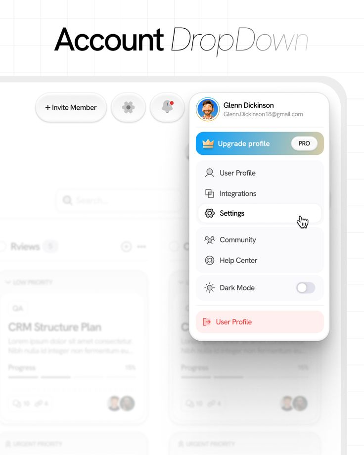

# Dashboard Profile Dropdown

A minimal dashboard header with a polished account profile dropdown. Built with **vanilla HTML, CSS, and JavaScript**—no frameworks, no build step.



## Features

- Responsive header with invite, settings, and notifications actions
- Profile menu with avatar, upgrade card, and navigation items
- Light and dark theme with preference saved in `localStorage`
- Keyboard support (`Escape` closes the menu)
- Accessible controls (`aria-expanded`, focus outlines, menu roles)
- Modular CSS and small, focused JS files

## Quick start

1. Clone or download this repository.
2. Open `index.html` in a browser (or serve the folder with any static server).
3. Click the avatar in the top-right to open the account menu.

```bash
# Optional: local server (Python)
python -m http.server 8080
# Then visit http://localhost:8080
```

## Project structure

```
├── index.html
├── assets/
│   └── image.jpeg          # Preview / profile image
├── css/
│   ├── main.css            # Imports all stylesheets
│   ├── variables.css       # Design tokens (light & dark)
│   ├── base.css
│   ├── header.css
│   ├── profile-menu.css
│   └── responsive.css
└── js/
    ├── config.js           # Profile name, email, avatar URL
    ├── profile-dropdown.js # Menu open/close & item selection
    ├── theme.js            # Dark mode toggle
    └── main.js             # Bootstraps the page
```

## Customize your profile

Edit `js/config.js`:

```javascript
window.PROFILE = Object.freeze({
  name: "Your Name",
  email: "you@example.com",
  initials: "YN",
  avatarUrl: "assets/image.jpeg",
  themeStorageKey: "account-menu-theme",
});
```

Replace `assets/image.jpeg` with your own photo, or point `avatarUrl` to any valid image URL.

## Browser support

Modern browsers that support CSS custom properties, `backdrop-filter`, and ES5+ JavaScript.

## License

Free to use for learning and personal projects.

## Author

**Emranullah Rasoli** — [emranullahrasoli@gmail.com](mailto:emranullahrasoli@gmail.com)